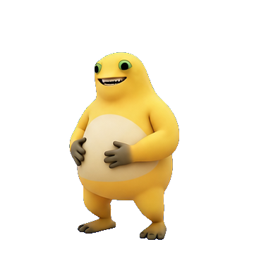

# 万物都可以做成桌宠

给 AI 一张图、一个角色，或者一个物件创意，把它做成能在桌面上互动的桌宠。

这是一份可供 Codex 调用的 skill，附带素材检查和 Scratch 素材提取工具。它把制作过程串起来：**原图角色 → 动作设计 → 桌面交互 → 构建与实测**。

<p align="center">
  
</p>

<p align="center"><strong>奶娃桌宠示例</strong> · 保留原图，点击弹跳，拖动定位</p>

图片展示的是本次实测样例。你可以换成自己的角色、动物、表情包、游戏精灵，或者水壶、灯泡、回形针等日常物件，再设计符合它们特点的动作。

## 可以做什么

| 桌宠形态 | 适合的玩法 |
| --- | --- |
| 常驻陪伴型 | 待在屏幕边缘，支持点击、拖动、低频动作与本机提醒 |
| 按需召唤型 | 从菜单或拖放入口出现，完成一段演出后退场 |
| 工具联动型 | 将角色动作连接到用户需要的任务、消息提醒或文件操作 |

制作过程中会检查角色比例、透明边缘、帧间锚点、音画同步、窗口输入与动作取消。只有一张静态图时，也可以先做点击位移、弹跳和程序效果，再逐步补充动画素材。

本仓库分享的是 **skill、制作指引和素材工具**。示例桌宠应用及原项目工程未打包在仓库里；新的桌宠需要根据你的素材和需求生成。

## 安装到 Codex

下载本仓库，或通过以下地址克隆：

```bash
git clone https://github.com/LKC0918/anything-to-desktop-pet.git
cd anything-to-desktop-pet
```

在仓库根目录执行：

```bash
skill_dest="${CODEX_HOME:-$HOME/.codex}/skills/anything-to-desktop-pet"
mkdir -p "$skill_dest"
cp SKILL.md "$skill_dest/"
cp -R agents references scripts "$skill_dest/"
```

如已安装同名 skill，先保留需要的本地修改。安装后，在 Codex 对话中附上素材并调用：

```text
使用 $anything-to-desktop-pet，把这张图片做成 macOS 桌宠。
保留原形象，平时安静待着，能拖动、点击跳一下，
菜单里可以隐藏、暂停和退出。完成后实际运行验证。
```

也可以从一个物件开始：

```text
使用 $anything-to-desktop-pet，把一只水壶做成桌宠。
点击开始专注，25 分钟后冒蒸汽提醒；支持暂停和立即测试提醒。
```

## 素材工具

需要 Python 3.9+。图片检查额外需要 Pillow，可使用现有项目环境或临时隔离环境。

```bash
# 检查单图、GIF/WebP 或当前层的图片序列；输出目录必须不存在
python3 scripts/pet_assets.py audit ./your-image.png --output ./new-asset-audit

# 查看 Scratch 工程中的角色、造型和声音清单
python3 scripts/pet_assets.py scratch ./character.sb3

# 按角色名提取原始资源，保留旋转中心、倍率和来源信息
python3 scripts/pet_assets.py scratch ./character.sb3 \
  --target "角色名" --output ./new-character-assets
```

`audit` 生成 JSON 和深浅背景联系表。`scratch` 支持 `.sb2`、`.sb3`、`.sprite2`、`.sprite3`，只提取资源，不运行积木代码；SVG 栅格化和动作分组需另行处理。工具不会修改输入素材。

## 实测结果

本次用这份 skill，从一张透明 PNG 制作了原生 macOS 桌宠，完成 **13 项真实 GUI 检查与 23 项逻辑/资源断言**：

- 拖动可改变位置，释放时不会误触跳跃。
- 点击可见弹跳并回位；顶边空间不足时向下反馈。
- 暂停会停止动作、禁用动作菜单，仍可拖动。
- 隐藏后能从菜单栏恢复，位置不丢失。
- 退出后进程消失，独立重启后恢复保存的位置。

实测环境为 **macOS 27.0.1、Apple Silicon、单屏**。其他系统、架构与实际多屏环境尚未验收；skill 会根据目标环境选择并验证实现方案。[查看脱敏验证说明](docs/verification.md)。

## 文件导航

- [SKILL.md](SKILL.md)：Codex 的技能入口。
- [形象、动作与素材](references/design-and-assets.md)：把对象特征转成动作，处理图片、GIF、逐帧与 Scratch。
- [桌面运行与验证](references/desktop-runtime-and-validation.md)：窗口、输入、状态流程与实际验收。
- [项目经验与边界](references/project-evidence.md)：两个来源工程中可复用的方法与已知限制。
- [pet_assets.py](scripts/pet_assets.py)：素材检查与提取工具。
